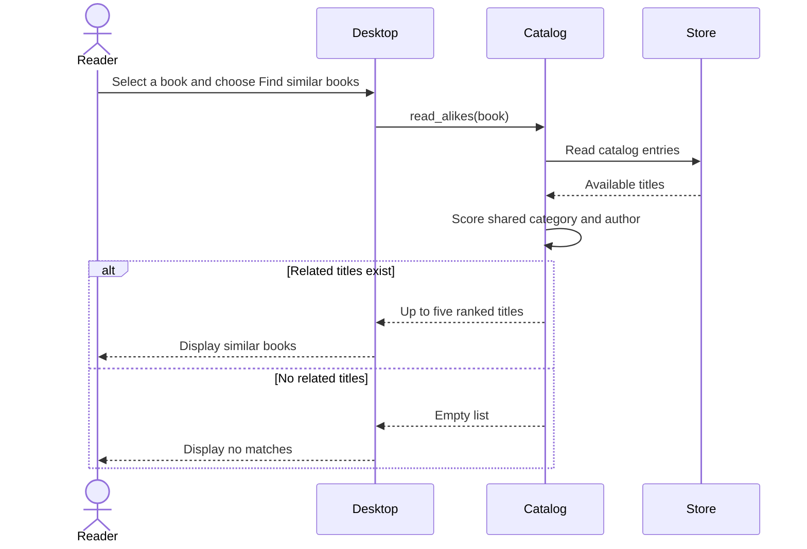
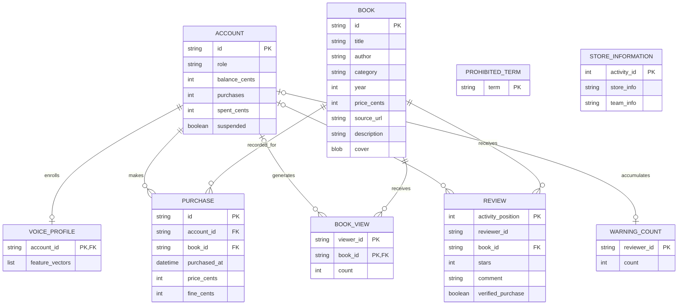
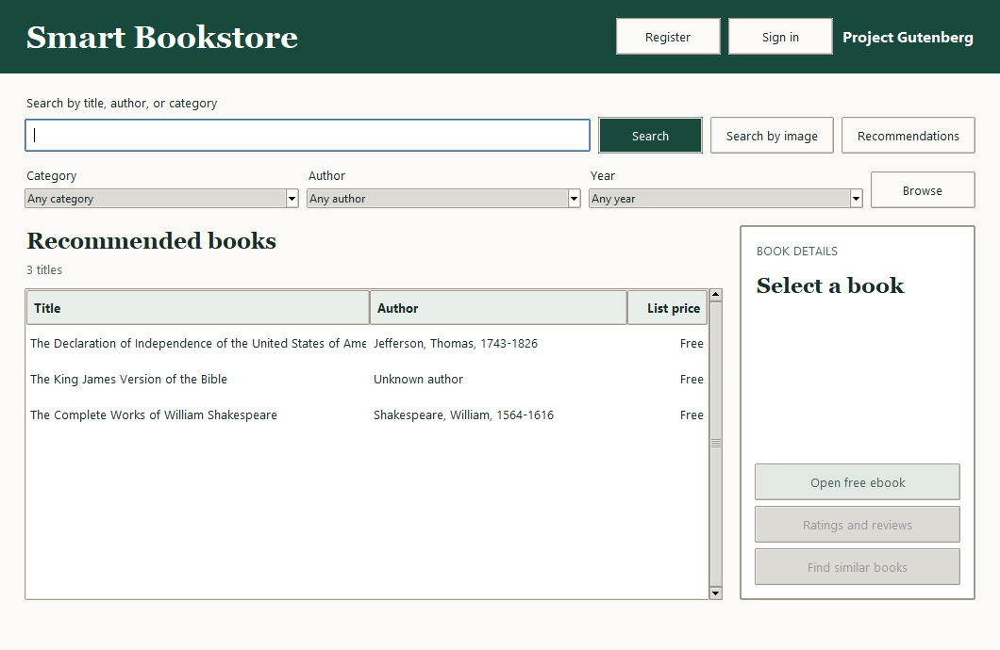
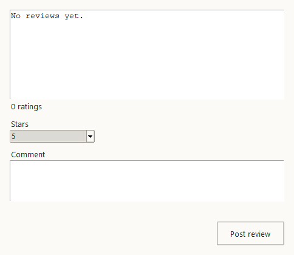
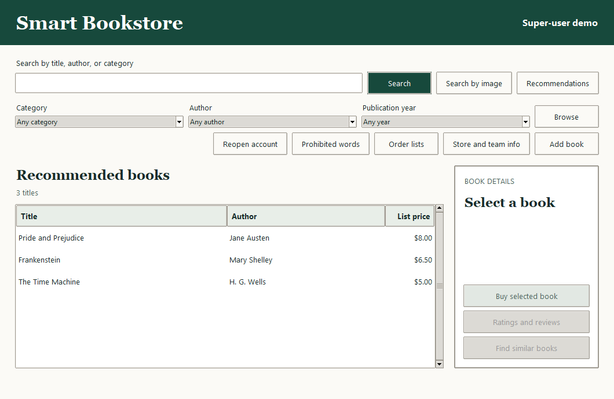
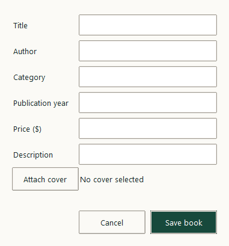
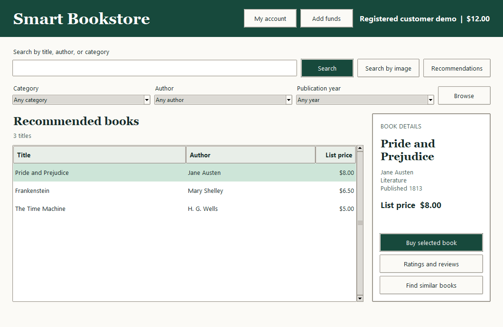
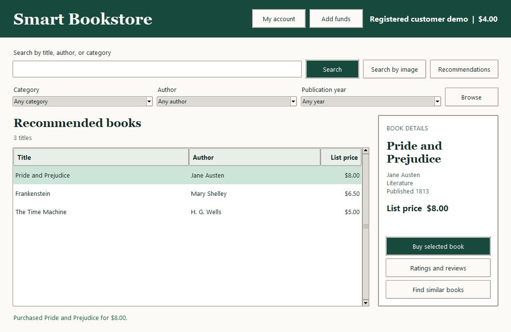
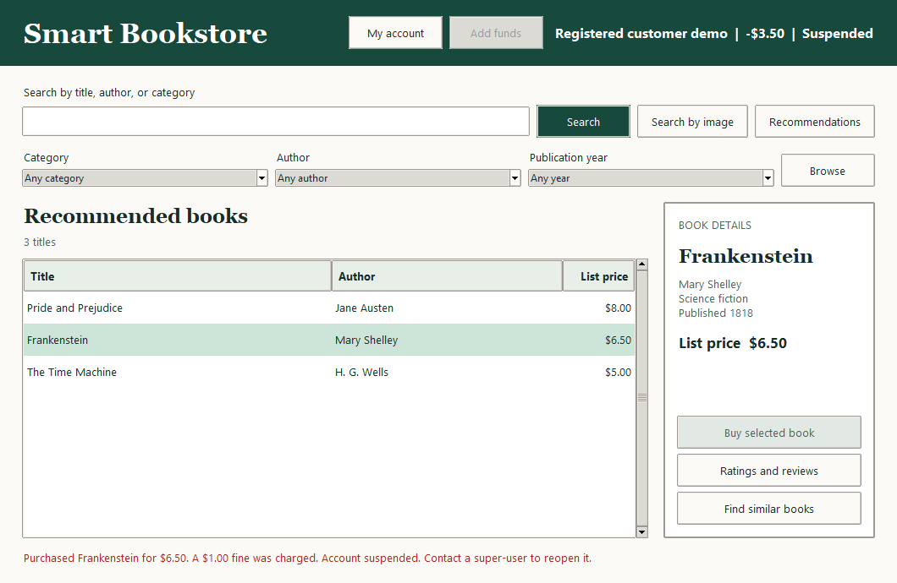

# Phase II Design Report

| Item | Details |
| --- | --- |
| Course | CS 322 |
| Project | AI-Enabled Multimodal Smart Bookstore |
| Team | JWD |
| Team members | Wesley Wu, Steve Corea, Mohammed Islam, [Everyone please fill this out] |
| Deadline | Tuesday, November 24, 2026, at 11:59 p.m. |
| Submission | 322 report upload portal |

## 1. Introduction

### System Overview

The desktop bookstore brings together the Gutenberg catalog, locally added books, customer checkout, reviews, and super-user management. The desktop sends catalog, account, and review actions to `Catalog`, `Accounts`, and `Reviews`. These services share the working `Store`. The local catalog and account activity are stored in separate SQLite files. `Authentication` checks the session account against a microphone-based voice classifier; the chat classes are reserved for the Ollama/RAG phase.

### Collaboration Class Diagram


## 2. Use Cases

The numbers match the team’s existing diagram exports. Alternate and exceptional flows are included in the paired sequence diagrams where available.

| Use case | Normal scenario | Exceptional or alternate scenario | Figures |
| --- | --- | --- | --- |
| UC-01 Registration and sign-in | A visitor enrolls three microphone samples as an RC. A returning RC, VC, or SU signs in with a voice sample. | Cancelled or unusable enrollment leaves no account. Unknown, ambiguous, or suspended accounts cannot sign in. A microphone error leaves the visitor session open. | [Sign-in](diagrams/useCase1.svg), [enrollment](diagrams/useCase1_2.svg) |
| UC-02 Browse | Choose a category, author, or year, then open a title. Selecting a title records a view. | No matches gives an empty state. Visitors can open details and contribute to overall activity. | [Sequence](diagrams/useCase2.svg) |
| UC-03 Search | Search by keywords, JPEG/PNG, or both. Image results rank by similarity against locally available references. | An unreadable image gives feedback. No matches leaves the search criteria available. | [Keyword](diagrams/useCase3.svg), [image](diagrams/useCase3_2.svg) |
| UC-04 Recommendations | Return the top three based on personal activity for RC/VC and overall activity for VS/SU. | An RC/VC without history gets overall results. A small catalog returns fewer than three. | [Personal](diagrams/useCase4.svg), [overall](diagrams/useCase4_2.svg) |
| UC-05 Chat | Planned. Check role access, retrieve relevant local material, and label the answer RAG or LLM. | Planned. Reject restricted queries and report an unavailable provider. | [RAG](diagrams/useCase5.svg), [LLM](diagrams/useCase5_2.svg) |
| UC-06 Purchase | Show the price and ask for confirmation, then record the purchase and debit the balance. VIPs receive 10% off. | Cancel leaves the balance alone. As shown in the team diagram, confirmed underfunded purchases charge the price plus a $1 fine and suspend the account if the resulting balance is negative. | [Petri net](diagrams/PN_UC6.svg), [normal](diagrams/useCase6.svg), [underfunded](diagrams/useCase6_2.svg) |
| UC-07 Account and deposits | An active customer views balance, purchase history and warnings, then deposits a positive amount. | Invalid deposits leave the balance alone. A suspended customer needs a super-user to reopen the account. | [Sequence](diagrams/useCase7.svg) |
| UC-08 Ratings and reviews | A signed-in RC or VC submits 1–5 stars and a comment, once per title. Mask prohibited terms, weight verified purchases at 2×, and derive the order-list status. | More than three prohibited words blocks the review and records a warning. Visitors, super-users, and suspended accounts can read reviews but not post them. A second review of the same title is rejected. | [Petri net](diagrams/PN_UC8.svg), [submission](diagrams/useCase8.svg), [order lists](diagrams/useCase8_2.svg) |
| UC-09 Account status | Promote an eligible RC to VC. An SU can reopen a suspended account as RC with a deposit that restores a positive balance. | An RC with three warnings is suspended and a VC with three warnings is demoted. An insufficient reopening deposit leaves the account suspended. | [Petri net](diagrams/PN_UC9.svg), [status checks](diagrams/useCase9.svg), [reopening](diagrams/useCase9_2.svg) |
| UC-10 Add book | An SU enters bibliographic details and price, optionally attaches a JPEG/PNG cover, and saves. | Invalid fields or an unreadable cover produce feedback. Cancel leaves the catalog alone. | [Sequence](diagrams/useCase10.svg) |
| UC-11 Store and team information | An SU updates store and team notes and maintains the prohibited-word list. | The editing controls are restricted to an active SU. A failed save keeps the previous information. Retrieval indexing is scheduled for the chat phase. | [Sequence](diagrams/useCase11.svg) |
| Creative feature | Select a title and choose **Find similar books** to see up to five matches ranked by category and author. | If no similar titles exist, the catalog shows an empty state. | See the sequence diagram below. |

### Creative feature sequence



### Implementation choices reflected in the code

The voice path is implemented for UC-01. The class diagram also shows a face path and raw sample paths. The app stores only derived voice features in the local activity database and does not implement face capture. Monetary fields use integer cents. Browse history stores an aggregate count per viewer and title. Purchase records separately preserve timestamps, amounts, and fines. Store/team notes and prohibited terms persist now; the RAG indexing step stays in UC-05. Gutenberg entries link to their free ebook pages, and checkout applies to local paid entries.

## 3. E-R Diagram

### System-wide E-R Diagram



### Entities, Attributes, and Keys

| Logical entity | Identifier and fields |
| --- | --- |
| Book | PK `id`; title, author, category, optional year, price cents, optional source URL, description, optional cover bytes |
| Account | PK `id`; role, balance cents, purchase count, total spent cents, suspended flag |
| VoiceProfile | PK/FK `account_id`; three feature vectors |
| Purchase | PK `id`; FK `account_id`, FK `book_id`, UTC purchase time, price cents, fine cents |
| BookView | Composite key `viewer_id` and `book_id`; count. The visitor key identifies the local visitor role. |
| Review | Logical key `activity_position` (the position in the review list), reviewer ID, FK `book_id`, stars, masked comment, verified-purchase flag |
| WarningCount | PK `reviewer_id`; count |
| ProhibitedTerm | PK normalized term |
| StoreInformation | Singleton with logical key `activity_id` equal to 1, store notes, and team notes |

Purchased-book counts are cached for recommendations and verified reviews. The E-R diagram is logical. Account activity records are serialized together in a revisioned SQLite row, and local books use their own SQLite table.

## 4. Detailed Design

### Method pseudocode

The signatures show each routine's input and output. `UI` means the routine updates widgets or opens a dialog. `None` denotes either cancellation or a routine with no return value, depending on the signature. Monetary arguments ending in `_cents` are integers. Nested handlers read the widgets and session state created by their enclosing routine. Record fields are listed in Section 3. Python generates field-assignment constructors for the data classes.

#### Application startup and catalog import

```text
money(cents) -> string
  Split absolute cents into dollars and remainder
  Format with a dollar sign, two decimal places, and a leading minus if negative

main(command-line arguments) -> terminal output or desktop
  Parse mutually exclusive sync, demo, VIP demo, admin demo, and admin enrollment modes
  If sync requested, download and validate Gutenberg CSV, print count, and exit
  Build sample store for demo modes, otherwise load Gutenberg books and persisted activity
  Merge locally added books for the normal app and admin demo
  If setup fails, report the error and exit with failure
  If provisioning an admin, record three samples, enroll the username as SU, and exit
  If listing books, print title, author, and price or Free, then exit
  Select the demo actor if requested, or start as visitor in the normal app
  In the admin demo, seed one suspended account for reopening
  Launch the desktop with the store and selected actor

load_books(path) -> book ID to Book map
  Open the UTF-8 CSV and require the Gutenberg catalog columns
  For each row, skip non-text items and invalid IDs or missing titles
  Parse the ebook release year when available
  Choose the first category shelf, then any shelf, then Uncategorized
  Construct a free entry with PG-prefixed ID and Gutenberg ebook URL
  Reject a catalog with no usable records, otherwise return the map

download_catalog(path) -> imported book count
  Download to a temporary file in the destination directory
  Verify the advertised byte count when supplied
  Parse the temporary CSV to validate it and count valid entries
  Replace the old cache only after the checks pass
  Remove the temporary file if it remains and propagate errors
```

#### Catalog and image matching

```text
Catalog.__init__(store) -> Catalog
  Keep the shared Store reference

Catalog.browse(category, author, year) -> list of Book
  Visit all catalog entries
  Keep case-insensitive exact category, case-insensitive author substring,
    and exact year matches for the filters supplied
  Return the matching entries in catalog order

Catalog.search(keywords, image) -> list of Book
  Case-fold and split keywords into terms
  Keep entries whose title, author, category, or description collectively contain every term
  If image bytes were provided, rank those entries by image similarity
  Otherwise return the text matches in catalog order

Catalog.open_book(book_id, viewer_id) -> Book
  Find the book by ID and increment the view count keyed by viewer and book
  Return the book or propagate a missing ID error

Catalog.add_book(actor, book) -> None
  Require an active super-user and a unique nonblank book ID
  Require title, author, and category and reject a negative price
  If local storage is configured, save the entry before adding it to memory
  Insert it into the working catalog

Catalog.recommendations(account) -> up to 3 Books
  Use that account's activity for RC or VC and all activity for VS or SU
  Sum browse and purchase counts for titles that still exist
  If a customer has zero personal activity, use the overall ranking
  Sort by descending count and then ascending book ID and return the first three

Catalog.read_alikes(book) -> up to 5 Books
  Skip the selected title itself
  Score two points for matching category and one for matching known author
  Exclude zero scores and sort by descending score, title, then ID

read_image(path) -> bytes
  Read at most 10 MiB plus one byte and reject a file over the limit
  Return bytes or propagate a file read error

image_signature(data) -> 64-bit edge hash and 48 color values
  Decode only JPEG or PNG and reject images above 20 million pixels
  Apply EXIF orientation and resize grayscale pixels to 9 by 8
  Compare each horizontally adjacent pair to form 64 bits
  Resize RGB pixels to 4 by 4 and flatten the channels

rank_images(query, books, directory) -> ordered list of Book
  Compute the query signature and group supported local files by book ID in the filename
  Compare each candidate's stored cover and its local reference files
  Skip unreadable local reference files
  Keep the best distance per book if it is at most 0.22
  Return books sorted by ascending distance and book ID

rank_images.distance(data) -> number
  Compute the reference signature
  Return 0.7 times normalized edge differences plus 0.3 times normalized RGB error
```

#### Accounts, checkout, and reviews

```text
Accounts.__init__(store) -> Accounts
  Keep the shared Store reference

Accounts._active_customer(account_id) -> Account
  Look up the account and reject suspended accounts and roles outside RC or VC

Accounts._validate_amount(amount_cents) -> None
  Require a positive integer number of cents

Accounts.deposit(account_id, amount_cents) -> balance cents
  Require an active customer and a valid amount
  Add the deposit and return the new balance

Accounts.reopen(actor, account_id, amount_cents) -> balance cents
  Require an active SU and a valid deposit
  Load the target account and require suspension and a resulting positive balance
  Apply the deposit, reactivate the account as RC, and return the balance

Accounts.purchase_price(price_cents, role) -> cents
  For VC return floor((90 * price_cents + 50) / 100), otherwise return list price

Accounts.checkout(account_id, book_id) -> CheckoutResult
  Require an active customer and a purchasable entry
  Compute the price and set a 100-cent fine if price exceeds current balance
  Debit price plus fine and increment purchase count and total paid, excluding the fine from spend
  Add a dated purchase record and increment the account's count for the book
  Suspend if the new balance is negative
  Otherwise promote an RC if purchases exceed 3 or total spent exceeds 20000 cents
  Return purchase status, price, balance, fine, suspension flag, and role

Reviews.__init__(store) -> Reviews
  Keep the shared Store reference

Reviews.reviewer(reviewer_id) -> Account
  Look up the account and reject a missing, suspended, or non-customer account

Reviews.submit(reviewer_id, book_id, stars, comment) -> Review
  Require an active RC or VC reviewer, an existing book, and integer stars 1 through 5
  Reject a second review of the same book by the same reviewer
  Count whole-word matches in the normalized prohibited set
  If more than three matches, increment warnings and apply role rules above two warnings
    Demote VC to RC or suspend RC, then signal a blocked review
  Otherwise mask matched words, determine whether the reviewer purchased the book,
    append the accepted review, and return it

Reviews.order_status(book_id) -> standard, to-order, or no-order
  Select the book's reviews and return standard if count is at most three
  Weight each verified review twice and every other review once
  Compare weighted points to 2 times total weight and 4 times total weight
  Return no-order below the lower bound, to-order above the upper bound, otherwise standard

Reviews.update_taboo_term(actor, term, remove) -> None
  Require an active SU and one valid term after trimming and case-folding
  If remove is true, discard the term if present, otherwise add it to the set
```

#### Voice authentication and planned chat

```text
BiometricClassifier.identify(modality, sample) -> account ID or None
  Interface contract: classify a supported sample and return a matching account ID or no match

Authentication.__init__(store, classifier) -> Authentication
  Keep references to the working store and classifier

Authentication.sign_in(modality, sample) -> Account
  Require a supported modality and nonempty sample
  Resolve the classifier's account ID and load its account
  Reject no match, a missing account, a visitor role, or suspension
  Return the matched active account

record_sample() -> WAV bytes
  Open the default microphone and record three seconds of mono 16-bit audio at 16 kHz
  Report an unavailable device or missing dependency
  Encode the recording as PCM WAV bytes

voice_features(sample) -> normalized numeric vector
  Decode a mono 16-bit, 16-kHz WAV and reject short, quiet, or unreadable samples
  Split into overlapping frames and remove frames below the energy threshold
  Compute a windowed FFT and mean energy in each frequency band
  Log and center band energies, combine per-band median and spread, and normalize

VoiceClassifier.__init__(store) -> VoiceClassifier
  Keep the shared store and use its enrolled voice profiles

VoiceClassifier.identify(modality, sample) -> account ID or None
  For voice, compute the sample feature vector
  Score each enrolled account by its strongest dot product with a saved vector
  Reject a missing score, a best score below 0.88, or a lead below 0.025 over the runner-up
  Return the best account ID if it passes all checks

VoiceClassifier.enroll(username, samples, role) -> Account
  Normalize username, validate its format, and reject a duplicate
  Require exactly three recordings and extract every feature vector before writing
  In one activity update, create a zero-balance account and save its feature vectors
  Return the enrolled account

Chat.__init__(provider) -> Chat
  Keep a reference to the supplied provider

Chat.answer(role, question) -> ChatAnswer
  Trim the question, reject blank input, and call the authorization check
  Ask the provider for a relevant local answer
  If a local answer exists, return it with source RAG
  Otherwise request a generated answer and return it with source LLM

ChatProvider.authorize(role, question) -> None or access error
  Planned provider: classify the requested data and check role permissions
  Deny restricted information before retrieval or generation

ChatProvider.retrieve(role, question) -> string or None
  Planned provider: search role-permitted store and team passages
  Return a grounded answer when relevant or None when no passage meets the relevance rule

ChatProvider.generate(role, question) -> string or provider error
  Planned provider: send the allowed question and public instructions to local Ollama
  Return the generated answer or surface a service failure to the chat screen
```

#### Local storage and rollback

```text
LocalCatalog.__init__(path) -> LocalCatalog
  Keep the path to the local SQLite catalog

LocalCatalog.prepare(connection) -> None
  Create the books table if needed
  Inspect existing columns and add description or cover columns if missing

LocalCatalog.load() -> book ID to Book map
  Return an empty map for a missing database file
  Otherwise open a transaction, prepare the schema, and select saved rows
  Rebuild each row as a Book and return the map

LocalCatalog.save(book) -> None
  Open a write transaction and prepare the schema
  Insert the book metadata and cover bytes by ID, then commit
  Propagate SQL errors so the catalog can keep its existing entries

Store.change_activity() -> context manager
  Return the activity transaction context if persistence is configured
  Otherwise return a no-op context for demo data

demo_store() -> Store
  Build the fixed four-book catalog and one RC with an opening balance of 1200 cents
  Return their in-memory store

Activity.__init__(path) -> Activity
  Keep the SQLite path and start at revision 0

Activity.prepare(connection) -> None
  Create the single-row activity table if absent

Activity.load(store) -> None
  Prepare the table and read the current revision and state if present
  Decode saved JSON and restore it into the store

Activity.snapshot(store) -> serializable dictionary
  Copy accounts, counts, receipts, reviews, terms, warnings, voice profiles, and store/team notes
  Convert dataclasses and composite keys to serializable values

Activity.restore(store, state) -> None
  Convert saved role strings to enum values and rebuild account objects
  Reuse existing account objects where possible so GUI references remain valid
  Restore counts, receipts, reviews, terms, warnings, profiles, and notes

Activity.change(store) -> context manager
  Capture the previous snapshot and run the calling operation
  If the snapshot changed, save the new state
  On a raised error, restore the previous snapshot and re-raise the error

Activity.save(state) -> None
  Start a SQLite write transaction and read the saved revision
  Reject a stale writer to avoid overwriting a newer client's state
  Store serialized state with the incremented revision and commit
  Update the in-memory revision after the commit succeeds
```

#### Desktop window and event handlers

```text
configure_styles(root) -> UI
  Set Tk theme, fonts, colors, spacing, and styles for table, cards, buttons, and feedback

launch(store, demo, actor) -> None
  Run the desktop window for the current actor
  If it returned a session change, reopen with the returned actor
  Otherwise exit

run_window(store, demo, actor) -> (session changed, next actor)
  Create services and the window, attach role-appropriate actions, and populate recommendations
  Run the Tk event loop until the window closes or the user switches sessions
  Return the session change flag and actor selected by the handlers

run_window.add_filter(label, options) -> combobox
  Add a label and read-only selector to the filter row
  Select its first option and return the selector

run_window.refresh_filters() -> UI
  Collect unique categories, authors, and known years
  Fill each dropdown with its Any option and sorted values

run_window.update_balance() -> UI
  Show actor role and balance for a customer and show suspension if applicable
  Toggle the deposit control based on suspension
  For other actors show the super-user or Gutenberg label

run_window.selected_book() -> Book or None
  Read the selected catalog row ID and resolve it in the store

run_window.record_selection(event) -> UI
  If a newly selected book differs from the last viewed row, record the view in an activity transaction
  Report a storage error, remember the selection, and refresh the details panel

run_window.update_details() -> UI
  Render the selected book's title, author, category, year, description, and applicable price
  For Gutenberg entries provide the free ebook link
  Enable reviews and similar books for a selected entry
  Enable paid checkout only for an active customer with a selected local book

run_window.show(books, label) -> UI
  Clear the selection and replace table rows with up to 250 results
  Display the result count or empty-state text and refresh the details panel

run_window.reset_filters() -> UI
  Set each category, author, and year control to its Any option

run_window.browse() -> UI
  Clear keyword input and convert current filters to browse arguments
  Filter results to the exact displayed author when an author option is selected
  Display browse results

run_window.search(event) -> UI
  Reset dropdowns and search using the current keyword text
  Display search results or all books for blank text

run_window.search_image() -> UI
  Ask for a JPEG or PNG and stop if cancelled
  Load the file and search using its bytes and current keywords
  Report unreadable images or display ranked matches and reset dropdowns

run_window.recommend() -> UI
  Reset dropdowns and clear the keyword box
  Display the top three for the current actor

run_window.checkout() -> UI
  Stop if nothing is selected
  If the book has a Gutenberg URL, open it and report browser failure
  Otherwise calculate the customer's price, explain any fine, and request confirmation
  If confirmed, run checkout inside an activity transaction
  On success display the purchase, new balance, fine, and suspension when applicable
  On a service or storage error display feedback and keep the saved balance unchanged

run_window.similar_books() -> UI
  If a book is selected, display its read-alike results

run_window.open_reviews() -> UI
  If a book is selected, open its review dialog for the current reviewer
  Refresh balance and purchase controls after the dialog closes

run_window.add_book() -> UI
  Open the SU form and stop if cancelled
  Refresh filters, show and select the saved book, and display confirmation
  Skip recording this programmatic selection as a customer view

run_window.switch_session(new_actor) -> UI
  Save the replacement actor, flag a session change, and close the current window

run_window.sign_in() -> UI
  Run the voice dialog and switch sessions only if it returns an account

run_window.add_funds() -> UI
  Run the customer's deposit dialog and show its success message
  Refresh the balance after a completed deposit

run_window.manage_reopening() -> UI
  Run the SU reopening dialog and display the result if completed
```

#### Dialogs and administrative controls

```text
voice_session(parent, store, register) -> Account or None
  For registration ask for a username and capture three microphone samples
  Cancel without enrolling if any prompt is cancelled
  Enroll the new customer, display confirmation, and leave the user in the visitor session
  For sign-in capture one sample and authenticate it
  Display error feedback for invalid samples, access failures, or SQLite errors

capture(parent, title, label) -> WAV bytes or None
  Ask the user to start or cancel
  Show the recording prompt in a temporary window
  Read the microphone and close the temporary window even if capture fails

ask_amount(parent, title, prompt) -> cents or None
  Ask for a dollar amount and return None if cancelled
  Validate a positive amount with up to two decimal places
  Convert valid input to cents and re-prompt after invalid input

deposit_funds(parent, accounts, customer) -> success text or None
  Ask for the deposit, then update the account within an activity transaction
  Show errors, or return the new balance and deposited amount as text

reopen_account(parent, accounts, admin) -> success text or None
  Show currently suspended accounts, then require a listed account ID and deposit amount
  Call the super-user reopening operation within an activity transaction
  Report failure or return the reopened account ID and balance as text

show_account(parent, accounts, customer) -> UI
  Show account ID, role, status, balance, warnings, and most recent purchases first
  Display each receipt's date, title, price, and fine when present

add_book_dialog(parent, catalog, actor) -> Book or None
  Open a modal with title, author, category, year, price, description, and cover controls
  Return the saved book or None when closed without saving

add_book_dialog.choose_cover() -> UI
  Ask for a JPEG or PNG, validate decoding and size, and retain the bytes on success
  Report failure without replacing the previous selected cover

add_book_dialog.save(event) -> UI
  Validate the year and decimal price and convert price to cents
  Generate a local ID and assemble a Book from the entered fields and optional cover
  Submit to Catalog.add_book and keep the dialog open if validation or storage fails
  Otherwise store the return value and close the dialog

edit_store_information(parent, store, actor) -> UI
  Require an active SU and display editable store and team notes

edit_store_information.save() -> UI
  Save both trimmed notes in one activity transaction
  Show a storage error or close on success

show_reviews(parent, service, book, reviewer_id) -> UI
  Open a modal with the current reviews
  Add the stars selector, comment field, and posting controls if Reviews.reviewer accepts the session
  Otherwise show a sign-in prompt in place of the posting controls

show_reviews.refresh() -> UI
  Display reviews for the book and calculate its purchase-weighted average when available

show_reviews.submit() -> UI
  Call Reviews.submit inside an activity transaction
  Catch a blocked-comment rejection inside the transaction so the warning is saved
  Show validation or storage errors; otherwise clear the comment and refresh the reviews

manage_terms(parent, service, admin) -> UI
  Open a modal with the current prohibited words and add/remove controls

manage_terms.refresh() -> UI
  Clear the list and display terms in sorted order

manage_terms.change(remove) -> UI
  Read the selected term to remove or prompt for a new term
  Update the list within an activity transaction and refresh it
  Display validation, permission, or storage errors

show_order_lists(parent, service) -> UI
  Evaluate each reviewed book's order status
  Show sorted to-order and no-order titles and omit standard titles
```

## 5. System Screens and Prototype

### Major GUI Screens

| Screen | Controls and visible results |
| --- | --- |
| Visitor catalog | Keyword and image search, category/author/year filters, top three, Register and Sign in |
| Book details | Description, price or free ebook link, ratings and reviews, similar books |
| Customer desktop | My account, Add funds, VIP pricing when applicable, and purchase confirmation |
| Super-user desktop | Add book, Reopen account, Prohibited words, Order lists, and Store and team info |

**Figure 1. Visitor catalog.** The main app opens in visitor mode with Gutenberg titles and access to browsing, search, voice registration, and sign-in.



**Figure 2. Ratings and reviews.** A selected book opens a panel for reading and posting reviews.



**Figure 3. Super-user desktop and book entry.** The action row groups catalog management, account reopening, moderation, and store or team notes. The **Add book** form accepts metadata, a price, and an optional cover.





### Sample Prototype

Run `python -m bookstore --demo` from the repository root to start with a $12.00 balance.

1. Select *Pride and Prejudice*. Review the $8.00 price before clicking **Buy selected book**.

   

2. Confirm the purchase. The confirmation message appears and the balance becomes $4.00.

   

3. Select the $6.50 *Frankenstein*. Cancel once to verify the $4.00 balance stays in place. Try again and confirm. The app charges $6.50 plus the $1.00 fine. The balance becomes −$3.50, the account is suspended, and purchase and deposit controls are disabled.

   

Use the separate super-user demo to test reopening `demo-suspended`, which begins at −$0.50. Depositing $0.50 leaves the account suspended; depositing $0.75 reopens it at $0.25. The main app persists these account changes across sessions.

## 6. Group Meetings and Teamwork

### Meeting Memos

### Teamwork Concerns

## 7. Git Repository

### Repository URL

[Team GitHub repository](https://github.com/WesleyW8542/CS-332-Project-JWD-)
