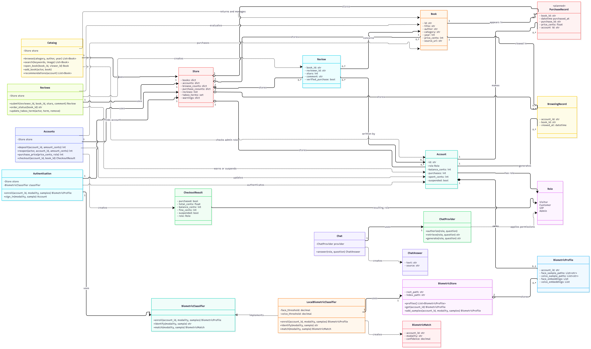
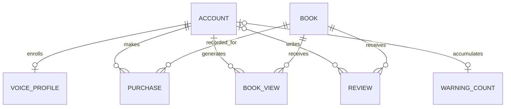

# Phase II Design Report

| Item | Details |
| --- | --- |
| Course | CS 322 |
| Project | AI-Enabled Multimodal Smart Bookstore |
| Team | JWD |
| Team members | Wesley Wu, Steve Corea, [Everyone please fill this out] |
| Deadline | Tuesday, November 24, 2026, at 11:59 p.m. |

## 1. Introduction

### System Overview

The desktop bookstore brings together the Gutenberg catalog, locally added books, customer checkout, reviews, and super-user management. The desktop sends catalog, account, and review actions to `Catalog`, `Accounts`, and `Reviews`. These services share the working `Store`. The local catalog and account activity are stored in separate SQLite files. `Authentication` checks the session account against a microphone-based voice classifier; the chat classes are reserved for the Ollama/RAG phase.

### Collaboration Class Diagram

## 2. Use Cases

The numbers match the team’s existing diagram exports. Alternate and exceptional flows are included in the paired sequence diagrams where available.

| Use case | Normal scenario | Exceptional or alternate scenario | Figures |
| --- | --- | --- | --- |
| UC-01 Registration and sign-in | A visitor enrolls three microphone samples as an RC. A returning RC, VC, or SU signs in with a voice sample. | Cancelled or unusable enrollment leaves no account. Unknown, ambiguous, or suspended accounts cannot sign in. A microphone error leaves the visitor session open. | [Sign-in](diagrams/useCase1.svg), [enrollment](diagrams/useCase1_2.svg) |
| UC-02 Browse | Choose a category, author, or year, then open a title. Selecting a title records a view. | No matches gives an empty state. Visitors can open details and contribute to overall activity. | [Sequence](diagrams/useCase2.svg) |
| UC-03 Search | Search by keywords, JPEG/PNG, or both. Image results rank by similarity against locally available references. | An unreadable image gives feedback. No matches leaves the search criteria available. | [Keyword](diagrams/useCase3.svg), [image](diagrams/useCase3_2.svg) |
| UC-04 Recommendations | Return the top three based on personal activity for RC/VC and overall activity for VS/SU. | An RC/VC without history gets overall results. A small catalog returns fewer than three. | [Personal](diagrams/useCase4.svg), [overall](diagrams/useCase4_2.svg) |
| UC-05 Chat | Planned. Check role access, retrieve relevant local material, and label the answer RAG or LLM. | Planned. Reject restricted queries and report an unavailable provider. | [RAG](diagrams/useCase5.svg), [LLM](diagrams/useCase5_2.svg) |
| UC-06 Purchase | Show the price and ask for confirmation, then record the purchase and debit the balance. VIPs receive 10% off. | Cancel leaves the balance alone. As shown in the team diagram, confirmed underfunded purchases charge the price plus a $1 fine and suspend the account if the resulting balance is negative. | [Petri net](diagrams/PN_UC6.svg), [normal](diagrams/useCase6.svg), [underfunded](diagrams/useCase6_2.svg) |
| UC-07 Account and deposits | An active customer views balance, purchase history and warnings, then deposits a positive amount. | Invalid deposits leave the balance alone. A suspended customer needs a super-user to reopen the account. | [Sequence](diagrams/useCase7.svg) |
| UC-08 Ratings and reviews | Submit 1–5 stars and a comment. Mask prohibited terms, weight verified purchases at 2×, and derive the order-list status. | More than three prohibited words blocks the review and records a warning. | [Petri net](diagrams/PN_UC8.svg), [submission](diagrams/useCase8.svg), [order lists](diagrams/useCase8_2.svg) |
| UC-09 Account status | Promote an eligible RC to VC. An SU can reopen a suspended account as RC with a deposit that restores a positive balance. | An RC with three warnings is suspended and a VC with three warnings is demoted. An insufficient reopening deposit leaves the account suspended. | [Petri net](diagrams/PN_UC9.svg), [status checks](diagrams/useCase9.svg), [reopening](diagrams/useCase9_2.svg) |
| UC-10 Add book | An SU enters bibliographic details and price, optionally attaches a JPEG/PNG cover, and saves. | Invalid fields or an unreadable cover produce feedback. Cancel leaves the catalog alone. | [Sequence](diagrams/useCase10.svg) |
| UC-11 Store and team information | An SU updates store and team notes and maintains the prohibited-word list. | The editing controls are restricted to an active SU. A failed save keeps the previous information. Retrieval indexing is scheduled for the chat phase. | [Sequence](diagrams/useCase11.svg) |
| Creative feature | Select a title and choose **Find similar books** to see up to five matches ranked by category and author. | If no similar titles exist, the catalog shows an empty state. | [Implementation](bookstore/catalog.py) |

### Implementation choices reflected in the code

The voice path is implemented for UC-01. The class diagram also shows a face path and raw sample paths. The app stores only derived voice features in the local activity database and does not implement face capture. Monetary fields use integer cents. Browse history stores an aggregate count per viewer and title. Purchase records separately preserve timestamps, amounts, and fines. Store/team notes and prohibited terms persist now; the RAG indexing step stays in UC-05. Gutenberg entries link to their free ebook pages, and checkout applies to local paid entries.

## 3. E-R Diagram

### System-wide E-R Diagram

### Entities, Attributes, and Keys

| Logical entity | Identifier and fields |
| --- | --- |
| Book | PK `id`; title, author, category, optional year, price cents, optional source URL, description, optional cover bytes |
| Account | PK `id`; role, balance cents, purchase count, total spent cents, suspended flag |
| VoiceProfile | PK/FK `account_id`; three feature vectors |
| Purchase | PK `id`; FK `account_id`, FK `book_id`, UTC purchase time, price cents, fine cents |
| BookView | Composite key `viewer_id` and `book_id`; count. The visitor key identifies the local visitor role. |
| Review | Stored as an ordered activity record; reviewer ID, FK `book_id`, stars, masked comment, verified-purchase flag |
| WarningCount | PK `reviewer_id`; count |
| ProhibitedTerm | PK normalized term |
| StoreInformation | Singleton; store notes and team notes |

Purchased-book counts are cached for recommendations and verified reviews. The E-R diagram is logical. Account activity records are serialized together in a revisioned SQLite row, and local books use their own SQLite table.

## 4. Detailed Design

### Class [Name]

#### Method [Name]

##### Inputs and Outputs

##### Pseudocode

## 5. System Screens and Prototype

### Major GUI Screens

| Screen | Controls and visible results |
| --- | --- |
| Visitor catalog | Keyword and image search, category/author/year filters, top three, Register and Sign in |
| Book details | Description, price or free ebook link, ratings and reviews, similar books |
| Customer desktop | My account, Add funds, VIP pricing when applicable, and purchase confirmation |
| Super-user desktop | Add book, Reopen account, Prohibited words, Order lists, and Store and team info |

Screenshot figures are pending.

### Sample Prototype

Use the registered checkout demo with its $12.00 opening balance. Buy *Pride and Prejudice* for $8.00 and verify the $4.00 remaining balance. Select the $6.50 *Frankenstein* next. Cancel the confirmation to leave the balance at $4.00, then repeat and confirm to charge $6.50 plus the $1.00 fine. The resulting balance is −$3.50, and purchase and deposit controls are disabled.

Use the separate super-user demo to test reopening `demo-suspended`, which begins at −$0.50. Depositing $0.50 leaves the account suspended; depositing $0.75 reopens it at $0.25. The main app persists these account changes across sessions.

## 6. Group Meetings and Teamwork

### Meeting Memos

### Teamwork Concerns

## 7. Git Repository

### Repository URL

[Team GitHub repository](https://github.com/WesleyW8542/CS-332-Project-JWD-)
